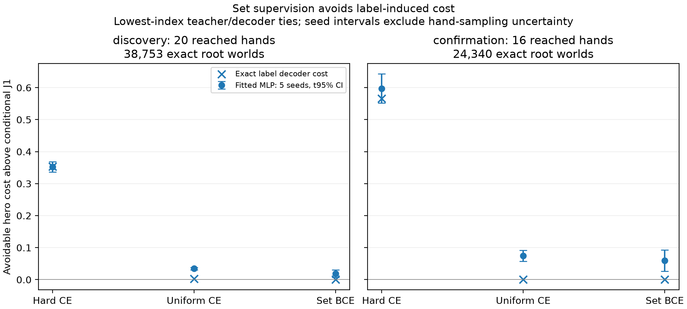
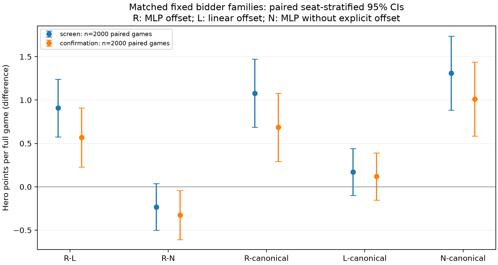

# Certified bounds and interventions for privileged distillation in Oh Hell

A reproducible audit of a fixed hidden-information decision task and separate
standard-game experiments. No novelty or general reinforcement-learning guarantee
is claimed.

## Abstract

We audit privileged-teacher learning in exactly enumerable four-player Oh Hell
subgames and a separate standard-game bidder experiment. At a first private
team decision, fully informed continuation makes both the information floor
and the cost of a chosen executable root action computable. In the 12-card
no-trump game, the information cost is exactly 421/30800 hero points over
369600 ordered deals. With both the hard teacher and the population label
decoder breaking ties by lowest original-hand index, hard labels incur another
7819/17600 points above the private root optimum; changing only decoder ties
gives the exact range [141121/369600,7819/17600]. Unnormalized optimal-action
membership has zero population decoding excess under this binary public payoff.
On two fixed held-out hand populations, membership BCE minus hard CE is
-0.33343 +/-0.02564 and -0.53785 +/-0.04233 points per free-root world
(n=5 paired fits, 95% t intervals). This avoids a label-induced cost; it does
not establish favorable learning dynamics. Hand-sampling uncertainty is not
measured by these seed intervals and dominates this interpretation. The
root-trained networks transfer poorly to fully private sequential deployment:
every large-game profile is worse than an existing feasible private policy.
A separate residual bidder gains about one point per full game in its fixed
canonical pool (<1% of a mean near165); the win gain did not replicate, and
no gain was detected in specified shift pools. Only the fixed
root information/representation/student chain is a nonnegative decomposition;
label, belief and sequential interventions must be compared separately.

## 1. Question and bounded relation to prior work

An action chosen by a privileged teacher may be a poor label for a student
that observes only its own cards and public history. Multiple optimal teacher
actions introduce another choice: which label information to retain. We ask
which costs can be certified exactly, which are induced by that label choice,
and which survive deployment beyond the one-decision task.

This mismatch is established prior work. [Warrington et al., ICML 2021](https://proceedings.mlr.press/v139/warrington21a.html)
adapt asymmetric experts to trainees. [Walsman et al., ICLR 2023, Impossibly
Good Experts and How to Follow Them](https://openreview.net/forum?id=sciA_xgYofB)
study experts whose information advantage cannot be imitated and recovery
under restricted information. [Cai et al., NeurIPS 2024](https://proceedings.neurips.cc/paper_files/paper/2024/hash/74d188c51d97fcfbc0269f584d6a53b7-Abstract-Conference.html)
already show one-step distillation failure. [Song, Rohatgi, Singh and Bagnell,
NeurIPS 2025, To Distill or Decide? Understanding the Algorithmic Trade-off in
Partially Observable RL](https://proceedings.neurips.cc/paper_files/paper/2025/hash/81343f8ebe529de8d0bb654af7523184-Abstract-Conference.html)
compare privileged distillation and partially observable RL. We inherit none
of their algorithmic guarantees.

Action-cost supervision is established by [Ross and Bagnell 2014](https://arxiv.org/abs/1406.5979)
and [Sun et al., ICML 2017](https://proceedings.mlr.press/v70/sun17d.html).
[Adam N. Elmachtoub and Paul Grigas, Smart “Predict, then Optimize”,
Management Science68(1):9–26,2022 (online2021)](https://pubsonline.informs.org/doi/10.1287/mnsc.2020.3922) study decision-focused
prediction. [Cour et al., JMLR 2011](https://jmlr.org/papers/v12/cour11a.html)
consider candidate sets with one correct label; here multiple actions can be
truly optimal. [Swamy et al., NeurIPS 2022](https://proceedings.neurips.cc/paper_files/paper/2022/file/708e58b0b99e3e62d42022b4564bad7a-Paper-Conference.pdf)
address sequential issues absent from the root relaxation. Direct
[Christopher Solinas, Doug Rebstock, Nathan Sturtevant and Michael Buro,
History Filtering in Imperfect Information Games: Algorithms and Complexity,
NeurIPS2023](https://proceedings.neurips.cc/paper_files/paper/2023/hash/87ee1bbac4635e7c948f3eea83c1f262-Abstract-Conference.html)
rules out a first-AI-for-this-game claim. Full-paper and benchmark comparisons
remain incomplete. The possible contribution is a reproducible, certified
audit artifact with explicit teacher ties and failed-transfer controls.

## 2. Exact contextual decision task and its limits

Four players follow suit; an exact bid scores 10+bid, a miss zero. The dealer
cannot make total bids equal hand size. We fix myopic bids and a deterministic
TA hero. The other players minimize that hero's score. Complete ordered deals
number 2520 for two suits/four ranks/two cards per player and 369600 for three
suits/four ranks/three cards per player, each with trump0 or no trump.
The acting student's observation contains only its original own hand, seat,
full public history, bids, rules and legal mask. Original-hand indices define
actions consistently.

At the first free team action, Q(w,a) is hero score after action a followed by
fully informed minimizing continuation. Terminal roots add a shared constant.
PI minimizes separately in each world; J1 minimizes over actions shared by
worlds with the same private/public history I. For phi=phi(I) alone and a
common legal index set within each representation class,

    PI <= J1 <= J_phi <= J_student.
    J_student - PI = (J1-PI) + (J_phi-J1) + (J_student-J_phi).

Only these three terms are nonnegative components of the same fixed objective.
The legal mask is part of phi. Full 241-feature encoding is injective on these
private keys, giving zero representation term. Coarser encodings define their
own J_phi; representation cost is not intrinsic information cost.

J_student is a **root relaxation with omniscient continuation**, not a feasible
full private-team policy. It cannot be compared as an achieved upper against
the M13 feasible private-policy upper. A hidden first-free-stage indicator is
not supplied to deployed policies. A private key can also arise later, since
a player cannot infer an earlier teammate's legal alternatives from public
history. M9 therefore executes its policy at every matching private key.

## 3. Exact supervision diagnostics

For this deterministic fixed hero, single-round exact-hit-or-zero score,
public bid b0, and PI continuation, Q(w,a) is either 0 or public c(I)=10+b0.
Penalty scoring, hidden or variable stakes, stochastic hero dynamics and
other continuation objectives need separate analysis. Let y indicate membership
in the complete optimal-action set. Then

    E[y(w,a)|I] = 1-E[Q(w,a)/c(I)|I] + P(all actions cost c(I)|I).

The last term is action-independent. Maximizing the conditional membership
probability thus minimizes conditional hero score. Proper independent BCE at
its unrestricted population optimum equals these per-key probabilities.
This is no claim about a finite regularized learner or held-out predictions.
Normalized-Q regression and direct expected cost have corresponding aligned
population decisions. Arbitrary hard ties and normalized optimal-set CE lack
this identity. The elementary proof and computed counterexamples are in M2.

Both teacher hard ties and default decoder ties use the **lowest sorted
original-hand index**. The bracketed ranges vary decoder ties with that teacher
fixed; they are exact complete-population ranges, not confidence intervals.

|condition|exact deals|J1-PI|hard excess, default [decoder best,worst]|uniform CE excess, default [best,worst]|membership excess, any decoder tie|
|---|---:|---:|---|---|---:|
|8-card trump|2520|0|0 [0,0]|0 [0,0]|0|
|8-card NT|2520|0|19/105 [1/42,19/105]|0 [0,0]|0|
|12-card trump|369600|25819/369600|101621/369600 [8293/33600,101621/369600]|257/52800 [191/52800,2819/369600]|0|
|12-card NT|369600|421/30800|7819/17600 [141121/369600,7819/17600]|19/30800 [3/30800,17/26400]|0|

No sampling CI applies. The strict information gaps are approximately 0.070
and 0.014 hero points; they certify strict cost and nothing about material
magnitude in standard 52-card play. Small NT hard excess is positive even under
the best decoder tie choice. Uniform CE is already much closer to optimal
than hard labels, so this does not establish a generally superior new loss.

A distinct, post-outcome exploratory axis changes the **teacher's global
priority**: all six large-NT priorities yield hard Bayes excess from
29039/92400 to17869/33600, and all six trump priorities from16449/61600 to
11923/36960 (369600 exact deals/condition, no CI). This is separate from the
fixed-teacher decoder ranges above. Averaging all priority label counts gives
uniform optimal labels exactly; context-dependent teacher priorities are not
covered.

## 4. Frozen learners: avoiding a label-induced cost

Own initial hands are hashed into 60/20/10/10 train/validation/discovery/
confirmation partitions shared across actor seats/histories. In each large
condition, discovery reaches20 hands and confirmation16 (22 potential hands
per split). Each small condition reaches only one held-out hand per split
(three potential). No world's key or own hand crosses splits.

Linear and 241->64->32->3 tanh MLP arms use hard CE, uniform-optimal CE,
optimal-membership BCE, normalized-Q regression and direct expected cost.
Five paired seeds share initialization/minibatches. Adam runs100 epochs;
selection among10/25/50/100 uses validation hero cost only. All200 fits freeze
before held-out evaluation. Large-NT MLP set-minus-hard is primary; both
held-out intervals must be negative. Other comparisons are descriptive.

|large-NT held-out set|exact root worlds|keys|reached hands|conditional information floor|hard decoder excess|uniform decoder excess|set decoder excess|
|---|---:|---:|---:|---:|---:|---:|---:|
|discovery|38753|4967|20|0.008825123|0.353391995|0.002786881|0|
|confirmation|24340|2549|16|0.031347576|0.565817584|0.000986031|0|

These are exact fixed-population quantities, no sampling CIs. Set-minus-hard
learner excess is -0.333430 +/-0.025643 and -0.537847 +/-0.042330
(n=5 paired fits, t95%CI, df4). The contrast largely reproduces the label-only
costs: **set supervision avoids a label-induced cost**, rather than showing
favorable learning dynamics. The conditional information floors differ by
held-out hands. Hand-sampling uncertainty dominates the interpretation and
is absent from the seed intervals. The two sets reuse the same fits.
Finite models can beat a label decoder, so label excess and fitting cost do
not form a nonnegative additive decomposition.

All targets derive from the same exact Q vectors, but hard CE retains less
information than set/uniform labels; Q/direct preserve costs. Equal worlds
and budgets do not equalize label richness or oracle-query cost. Uniform CE
is the essential same-set control; no label-efficiency claim. Small controls
do not uniformly favor BCE. M3 retains all200 fits, choices, raw actions and
unfavorable comparisons; independent raw/forward/selection checks and Claude's
external review pass.

M7's separate30-fit key-coverage curve uses25/50/100% nested training keys;
**all fractions contain all117 reached training hands**. At every fraction,
hard CE stays near its label floor. Discovery set-BCE excess goes from
0.086450 +/-0.011795 to0.023467 +/-0.016041 (five fits, t95%CIs); confirmation
is not monotone. No trend or independent-hand sample-efficiency claim.

## 5. Sequential failure and separate 52-card bidder controls

### Private sequential deployment (M9)

Frozen root MLPs act at every free private-team decision, without PI continuation
or a hidden root flag. Exact chance enumeration is separate from five-fit
optimization uncertainty. Large NT set-minus-hard is the primary descriptive
contrast. Root mis-decoding and later-key behavior are not causally separated:
16192/42440 NT and9164/41712 trump root keys can occur later (exact counts).

|condition|deals/profile|PI|J1|existing feasible upper|hard deployed, seed95%CI halfwidth|set deployed, seed95%CI halfwidth|
|---|---:|---:|---:|---:|---:|---:|
|small trump|2520|1257/140|1257/140|1257/140|8.978571 +/-0|9.308492 +/-0.468742|
|small NT|2520|946/105|946/105|946/105|9.371429 +/-0|9.371429 +/-0|
|large trump|369600|367921/61600|446669/73920|574247/92400|7.815024 +/-0.031443|7.533880 +/-0.059002|
|large NT|369600|106419/15400|213259/30800|109709/15400|8.235500 +/-0.033086|7.808720 +/-0.059056|

All learner intervals: n=5 fits, t95%CI; each fit's chance value is exact.
Every large-game deployed profile loses to the existing feasible policy.
Mean deployed-minus-upper is hard1.111539 +/-0.033086 and set0.684759 +/-
0.059056 in NT, hard1.600230 +/-0.031443 and set1.319086 +/-0.059002 in
trump (n=5,t95%CIs). NT set-minus-hard is -0.426780
[-0.473004,-0.380556], n=5 paired fits. Deployed set-BCE profiles score below hard-CE profiles (about-0.43 in large
NT), but both lose to the existing feasible policy; this does not attribute
the difference to root labels.
This motivates sequential training and a strategy-fusion probe, not a claim
that root distillation solves hidden teamwork.

Small trump hard CE is optimal in5/5 fits; set BCE is worse in3/5 fits
(raw-verified; the earlier external count of2/5 was an auditor error). All10small-NT profiles are
identical. With only one held-out hand/split, small students largely memorize
training hands. This mixes all teammate hand partitions, so it is not held-out
team generalization. Codex checked128fresh manual deals/profile; Claude's
independent full-deal replay of8/40profiles matched every deal. M9's protocol
was edited after M3 outcomes; it is disclosed as a post-outcome diagnostic.

### Residual bidders and shifts (M4/M5)

A separate standard52-card experiment fits canonical-offset residual hit
probabilities on40000 fresh NT contexts and selects epochs/blends on12000.
Actual ladder NT sizes are9,4,3,8,13. Five-fit ensembles freeze before
2000screen/2000confirmation CRN games; hero seat g%4, all TA+v2 play.
BCE-minus-canonical score is +1.2160 +/-0.3918 and +1.1120 +/-0.4067
points/game (n=2000/stage, paired equal-seat normal95%CIs). The score gain
replicates; the ties-as-win gain does not. BCE-minus-direct is null in both
stages. Canonical means and paired ratio intervals are in M4/RESULTS:
the score effect is under1% of means near165. This is the whole bidder
intervention against3canonical bidders, not a causal lead mechanism or human
benefit.

Frozen M5 BCE-minus-canonical effects are human-bidder screen+0.4430 +/-
0.6014, confirmation+0.0430 +/-0.5793; greedy-bidder screen+0.0310 +/-
0.5724, confirmation+0.1680 +/-0.5636 (n=1000/stage; paired equal-seat95%CIs).
No gain
is detected in the specified shift pools. Cross-pool differences were not
tested and remain descriptive; no general robustness failure/success claim.

Selection improvement was +0.193 +/-0.074 points/NTcontext on n=12000
reused selection contexts (optimistic descriptive95%CI); alpha1 was an
endpoint and3/5 fits selected the lowest epoch. Epoch/blend selection reused
the same data. In-run source/data hashes were preserved but source was first
committed post-run, with no selection noninferiority gate. Future protocols
require a Claude-reviewed pre-run commit and declared selection gate.

### Matched pipeline controls (M10)

M10 reuses frozen M4 train/validation data, fits five paired2060Mseeds per
family, and runs2000fresh2040Mscreen/2050Mconfirmation quadruplets. R is MLP
with explicit canonical logit offset; L linear with offset; N MLP without
explicit offset but **with canonical predictions as inputs**.

|contrast|screen points/game +/-95%CI|confirmation points/game +/-95%CI|n per stage|
|---|---:|---:|---:|
|R-L (primary)|+0.9080 +/-0.3334|+0.5675 +/-0.3401|2000|
|R-N|-0.2320 +/-0.2677|-0.3250 +/-0.2825|2000|
|N-L|+1.1400 +/-0.3855|+0.8925 +/-0.3993|2000|
|R-canonical|+1.0785 +/-0.3928|+0.6860 +/-0.3929|2000|
|L-canonical|+0.1705 +/-0.2707|+0.1185 +/-0.2727|2000|
|N-canonical|+1.3105 +/-0.4275|+1.0110 +/-0.4253|2000|

All intervals are paired equal-seat normal95%CIs conditional on fixed
five-fit ensembles. R-L score gain replicates; win gain does not (screen
+0.0060 +/-0.0096, confirmation+0.0085 +/-0.0108, n2000/stage). The rounded
score scale is0.3-0.5% of a canonical mean near167; full scale CIs are retained
in M10. N is descriptively best. An explicit-offset benefit does not replicate;
confirmation favors N over R. Linear-minus-canonical is null both stages.

R-L compares **selected pipelines**, not nonlinearity alone: L alpha0.5 vs
R/N alpha1 and different epochs. L selected top epoch50 in4/5 fits while
scores were rising; R selected bottom epoch10 in4/5. Grids did not bracket an
optimum. Exact selection score sums L79059/R80665/N80569 over12000contexts
are selection totals, not independent effect estimates. Source was modified
after M4 outcomes and first committed post-run. Separate verification checked
45candidate totals, all15models/ensembles,4000rawquadruplets and160fresh games;
Claude independently recomputed raw contrasts.

## 6. Artifact and limits

M1 stores portable integer costs, original-hand action indices, keys, masks,
target counts, chance counts, splits and hashes. Labels match audited PI/J1
rationals; fresh manual checks cover all2520small deals and64fixedlarge deals
per regime. This is not a fresh independent full large-population exporter.
M6 checks independently encoded predictions, all raw held-out costs and
selected models, seed/game CIs,52200counterfactual contexts,8000M4/M5triplets,
360freshfullgames, plus M10 controls. Test inventories include new diagnostic
modules and differ from earlier public snapshots. The pytest gate covers
engine/tests only, as configured by testpaths. The standalone verify scripts
are covered by their own JSON receipts, not by that pytest gate.

The empirical gates are small fixed experiments, not general RL guarantees.
Optimization CIs exclude hand/distribution uncertainty; fixed-ensemble game
CIs exclude refitting uncertainty. Label excess, belief error and sequential
strategy fusion can interact and are not nonnegative stacked costs. No hidden
team optimum, equilibrium, novel loss,52-card information gap, human benefit
or workshop acceptance follows. Original freezes, nulls, negative outcomes
and post-run provenance are preserved. N1-N7 are a new program, not completed
results.
